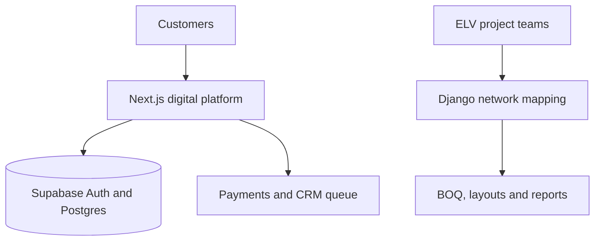

# ELV Digital Platform & Network Mapping

> Public case study for a private multi-application ELV platform combining customer acquisition, consultation workflows, and engineering project coordination.

## The challenge

An ELV business needs more than a marketing website. Customer consultation, booking, payment, technical content, products, and staff approvals must connect to the engineering work of mapping devices, calculating quantities, producing BOQs, coordinating installation, and reporting project progress.

## Delivered solution

The VISIS platform brings two complementary applications into one product family:

1. A multilingual Next.js business platform for consultation, booking, payments, customer/staff dashboards, technical content, academy, products, and CRM automation.
2. A role-based Django engineering tool for ELV network mapping, equipment libraries, BOQ/CSV output, installation checklists, tasks, floors, units, and riser layouts.

## Customer platform capabilities

- Persian, English, and Arabic routes with RTL support
- Consultation catalog, booking, time slots, project briefs, and approval workflow
- Free and paid booking paths with payment verification and invoices
- Customer and staff dashboards with role-based access
- Technical blog, academy, products, RFQ, cart, checkout, and order tracking
- Supabase authentication, PostgreSQL persistence, and row-level security
- Queued CRM synchronization processed through a protected scheduled route

## Engineering platform capabilities

- Invitation-based users and project-scoped roles
- Interactive ELV device maps and technical equipment records
- Seeded equipment library covering approximately 280 items in 18 categories
- Quantities, pricing, inventory fields, and BOQ/CSV export
- Installation checklists with author and timestamp capture
- Assignable project tasks, due dates, statuses, and completion reports
- Reusable floors/units and vertical riser layouts

## Technology

| Application | Stack |
|---|---|
| Digital platform | Next.js, React, TypeScript, Tailwind CSS, Supabase, Zod |
| Network mapping | Python, Django, Pillow, PyMuPDF, project database |
| Integrations | Payment gateway, Vtiger CRM queue, scheduled processing |
| Delivery | Vercel/self-hosted boundaries, Docker-compatible deployment |

## My contribution

- Structured the platform into clear customer, staff, content, commerce, and engineering domains
- Built multilingual routes, booking/payment flows, dashboards, and CRM automation
- Developed the role-based network mapping, BOQ, checklist, task, and layout capabilities
- Defined validation, authorization, persistence, and deployment boundaries
- Produced technical documentation for development, configuration, and operations

## Confidentiality

The production source, credentials, commercial data, and customer/project records remain private. This case study communicates verified capabilities and architectural decisions without revealing confidential implementation details.
